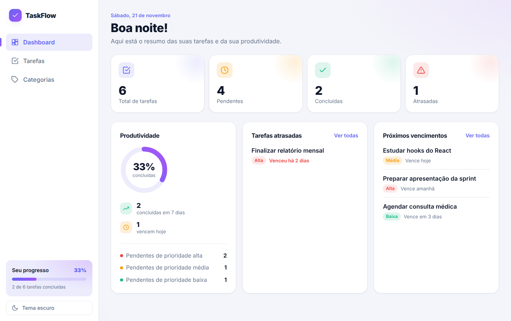
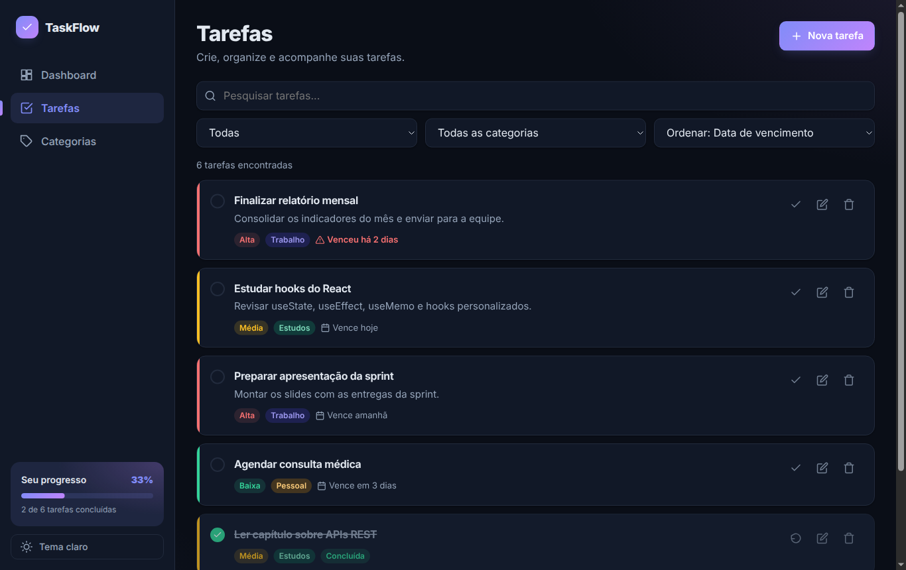
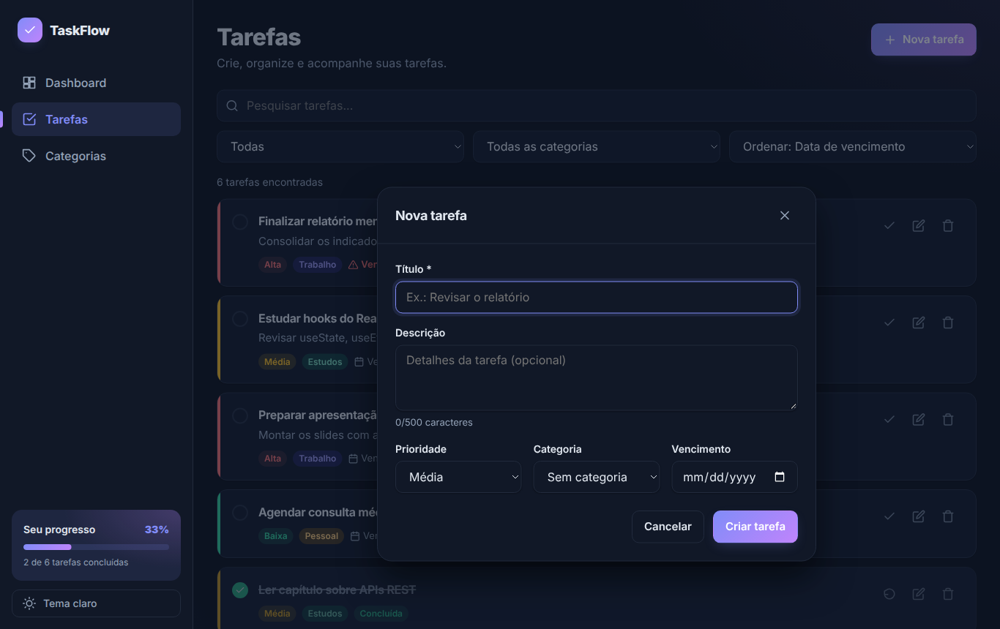
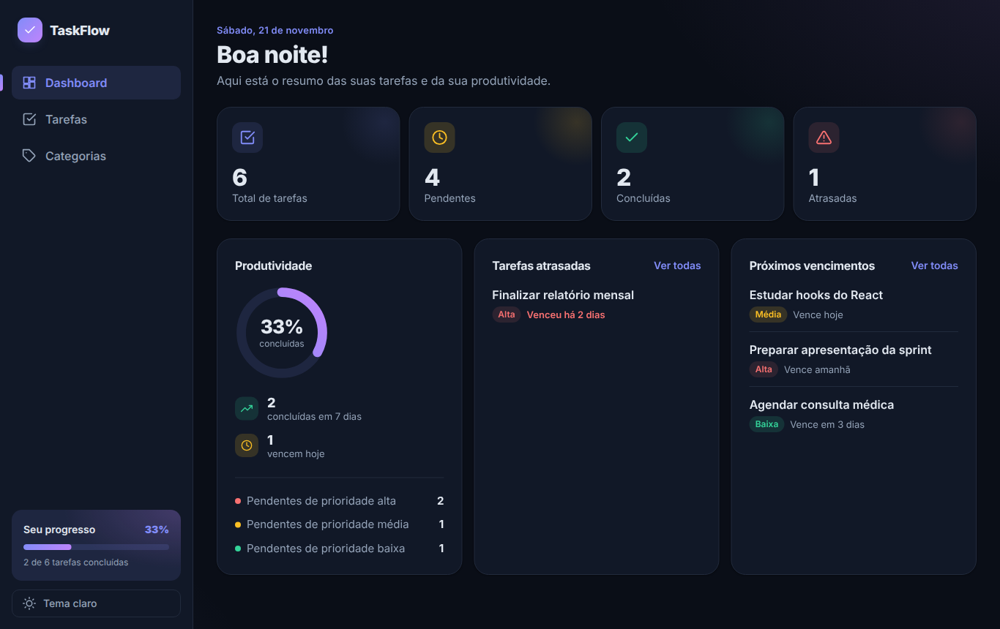
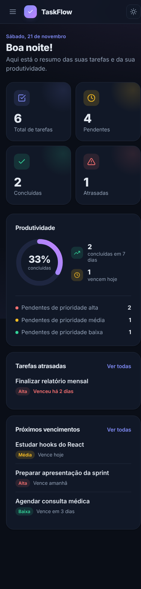

<div align="center">

# TaskFlow

**Gerenciador de tarefas full stack com autenticação JWT, dashboard de produtividade e tema claro/escuro.**

[](https://github.com/pedro-henrique-silva-dev/taskflow/actions/workflows/ci.yml)




</div>

## Sobre o projeto

O TaskFlow é uma aplicação web para organizar tarefas do dia a dia. O usuário cria uma conta, cadastra
tarefas com prioridade, categoria e data de vencimento, acompanha o que está pendente ou atrasado e vê
sua produtividade em um dashboard.

O projeto foi construído para praticar o desenvolvimento de um sistema completo: interface em React,
API REST em Node.js com arquitetura em camadas, banco relacional PostgreSQL e autenticação segura.

> **Status:** em desenvolvimento. Frontend e API estão prontos e testados; a integração entre eles
> está em andamento (veja o [roadmap](#roadmap)).

## Funcionalidades

- Cadastro, login e logout com **JWT**; senhas criptografadas com **bcrypt**
- Rotas privadas: cada usuário acessa apenas os próprios dados
- CRUD de tarefas: criar, editar, concluir, reabrir e excluir (com confirmação)
- Prioridade (baixa, média, alta), categoria personalizável e data de vencimento
- Pesquisa por texto, filtros por status e categoria e ordenação
- Dashboard com totais, pendentes, concluídas, atrasadas e taxa de conclusão
- Tema claro e escuro, layout responsivo (celular, tablet e desktop)
- Validação de dados no frontend e na API, com mensagens por campo
- Feedback visual: notificações, estados de carregamento e estados vazios

## Telas

| Tarefas (tema escuro) | Nova tarefa |
| --- | --- |
|  |  |

| Dashboard (tema escuro) | Celular |
| --- | --- |
|  |  |

## Tecnologias

| Camada | Tecnologias |
| --- | --- |
| Frontend | React 19, Vite, React Router, JavaScript, HTML5, CSS3 |
| Backend | Node.js, Express 5, Zod, bcryptjs, jsonwebtoken, Helmet, CORS |
| Banco de dados | PostgreSQL 16 (driver `pg`, SQL puro) |
| Qualidade | ESLint, node:test, Supertest, GitHub Actions |

## Arquitetura

```text
taskflow/
├── frontend/      # SPA em React + Vite
│   └── src/       # components, pages, hooks, context, services, styles, utils
├── backend/       # API REST em Node.js + Express
│   ├── src/       # config, routes, middlewares, validators, controllers, services, repositories, models
│   └── tests/     # testes de integração da API
├── database/
│   └── migrations/  # scripts SQL do esquema
└── docs/          # documentação técnica e screenshots
```

Cada requisição na API passa pelas camadas:

```text
routes → middlewares → validators → controllers → services → repositories → PostgreSQL
```

Mais detalhes em [docs/arquitetura.md](docs/arquitetura.md).

## Como executar

### Pré-requisitos

- Node.js 20.19+ e npm
- PostgreSQL 16+
- Git

### 1. Clonar o repositório

```bash
git clone https://github.com/pedro-henrique-silva-dev/taskflow.git
cd taskflow
```

### 2. Banco de dados

```bash
createdb -U postgres taskflow
psql -U postgres -d taskflow -f database/migrations/001_initial_schema.sql
```

### 3. API

```bash
cd backend
cp .env.example .env   # preencha DB_PASSWORD e JWT_SECRET
npm install
npm run dev            # http://localhost:3333/api
```

### 4. Frontend

```bash
cd frontend
npm install
npm run dev            # http://localhost:5173
```

## API REST

Prefixo: `/api`. Rotas marcadas com 🔒 exigem o cabeçalho `Authorization: Bearer <token>`.

| Método | Rota | Descrição |
| --- | --- | --- |
| GET | `/health` | Status da API e do banco |
| POST | `/auth/register` | Cria conta e retorna `{ user, token }` |
| POST | `/auth/login` | Autentica e retorna `{ user, token }` |
| GET | `/auth/me` 🔒 | Dados do usuário logado |
| POST | `/auth/logout` 🔒 | Encerra a sessão (o cliente descarta o token) |
| GET | `/categories` 🔒 | Lista categorias |
| POST | `/categories` 🔒 | Cria categoria |
| PUT | `/categories/:id` 🔒 | Edita categoria |
| DELETE | `/categories/:id` 🔒 | Exclui categoria (tarefas ficam sem categoria) |
| GET | `/tasks` 🔒 | Lista tarefas (`search`, `status`, `category`, `sort`) |
| GET | `/tasks/:id` 🔒 | Detalhe de uma tarefa |
| POST | `/tasks` 🔒 | Cria tarefa |
| PUT | `/tasks/:id` 🔒 | Edita tarefa |
| PATCH | `/tasks/:id/status` 🔒 | Conclui ou reabre (`pending` / `completed`) |
| DELETE | `/tasks/:id` 🔒 | Exclui tarefa |

Exemplo de criação de tarefa:

```http
POST /api/tasks
Authorization: Bearer <token>
Content-Type: application/json

{
  "title": "Estudar React",
  "description": "Revisar hooks e contexto",
  "priority": "high",
  "categoryId": null,
  "dueDate": "2026-12-01"
}
```

Erros seguem um formato único:

```json
{ "error": { "message": "Dados inválidos.", "details": { "title": "O título deve ter pelo menos 3 caracteres." } } }
```

## Testes

```bash
# Frontend
cd frontend && npm run lint && npm run build

# API (usa um banco separado cujo nome termina com "_test", pois os dados são apagados)
cd backend && DB_NAME=taskflow_test npm test
```

Os testes da API cobrem autenticação, validação, CRUD, filtros, ordenação e isolamento de dados entre
usuários. Eles rodam automaticamente no GitHub Actions a cada push.

## Segurança

- Senhas com hash bcrypt; o hash nunca é retornado pela API
- JWT assinado com segredo obrigatório de no mínimo 32 caracteres e com expiração
- Consultas SQL parametrizadas e filtradas pelo usuário autenticado
- Helmet, CORS restrito às origens do frontend e limite de tentativas no login e no cadastro
- Variáveis sensíveis em `.env`, fora do controle de versão

## Roadmap

- [x] Estrutura do projeto
- [x] Frontend com dados locais
- [x] API REST com autenticação JWT
- [ ] Scripts de migração e seeds do banco
- [ ] Integração do frontend com a API (login, cadastro e dados reais)
- [ ] Deploy

## Autor

**Pedro Henrique** · [GitHub](https://github.com/pedro-henrique-silva-dev)

## Licença

Distribuído sob a licença MIT. Veja [LICENSE](LICENSE).
